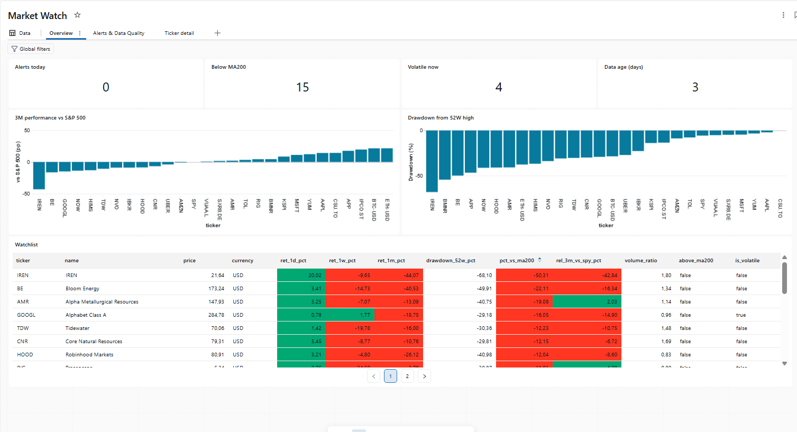
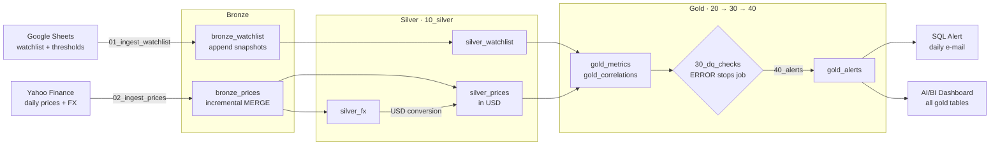
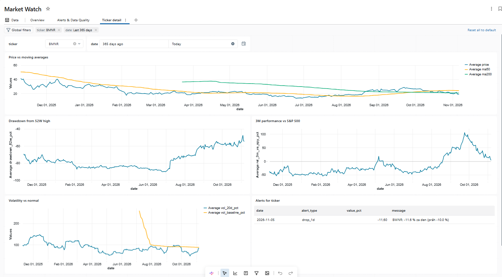
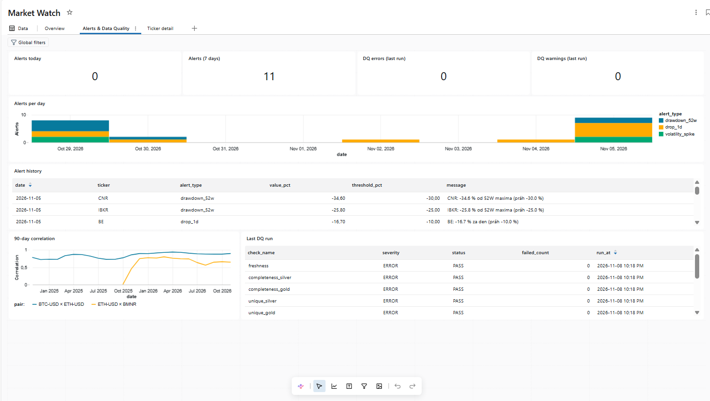

# Market Watch


A daily market monitoring pipeline on **Databricks**. It ingests prices for a personal watchlist of
stocks, ETFs and crypto, processes them through a **medallion architecture** (bronze → silver → gold),
runs **data quality checks**, sends **e-mail alerts** on significant drops and serves an **AI/BI dashboard**.



## Why

I follow ~30 stocks, ETFs and crypto assets and wanted one place that answers every evening:
*did something happen, is it cheap compared to its recent past, is it the market or the company –
and can I trust the numbers?* Instead of checking charts manually, the pipeline computes the metrics,
validates the data and only e-mails me when something crosses a threshold I set.

It is also a portfolio project: an end-to-end data engineering pipeline built the way I would build
one in production – incremental and idempotent loads, tested logic, data quality gates, documentation
and CI.

## Architecture



The whole pipeline runs as one **Lakeflow Job** every day at 23:15 (Europe/Prague), after the US close:

| Task | Notebook | What it does |
|---|---|---|
| 1 | `01_ingest_watchlist` | watchlist from a published Google Sheet → `bronze_watchlist` (append-only snapshots) |
| 2 | `02_ingest_prices` | daily prices from Yahoo Finance: full history for new tickers, last days for existing ones, FX pairs for non-USD currencies, `MERGE` on (ticker, date) |
| 3 | `10_silver` | typed watchlist, FX rates, prices converted to USD with forward-filled rates |
| 4 | `20_gold_metrics` | returns, 52-week drawdown, moving averages, volatility, volume, performance vs S&P 500, rolling correlations |
| 5 | `30_dq_checks` | 12 data quality checks – any ERROR fails the job, so alerts are never built from bad data |
| 6 | `40_alerts` | daily drop, 52-week drawdown crossing and volatility spike → `gold_alerts` (`MERGE`, no duplicates) |

A **Databricks SQL Alert** reads today's rows from `gold_alerts` and sends one summary e-mail.
A job failure sends a separate notification.

## Highlights

- **Incremental and idempotent loads** – new tickers get their full history, existing ones only the last
  days (with a small overlap to pick up source corrections). `MERGE` on business keys means a re-run never
  creates duplicates.
- **Data quality as a gate** – freshness, completeness, uniqueness, FX coverage and price validity checks.
  ERROR stops the pipeline before alerts; WARN is logged. Every run is stored in `dq_results`.
  [Details](docs/data_quality.md)
- **Metrics designed to be read, not just computed** – e.g. drawdown from the 52-week high instead of
  all-time high, volatility compared with the asset's *own* normal, performance vs S&P 500 in USD.
  [Business logic of every metric](docs/metrics.md)
- **Alerts without noise** – a drawdown alert fires once when the threshold is crossed, not every day
  the stock stays below it. [Alert rules](docs/alerts.md)
- **Config, not hard-coding** – table names, benchmark, correlation pairs and DQ limits live in
  [`src/lib/config.py`](src/lib/config.py); tickers and alert thresholds live in the watchlist sheet.
- **Tested logic** – pure Python helpers in `src/lib/` are unit-tested with pytest and linted with ruff
  on every push (GitHub Actions).

## Dashboard

Three pages, each answering one question. [Details](docs/dashboard.md)

| Overview | Ticker detail | Alerts & Data Quality |
|---|---|---|
|  |  |  |
| What is happening today? | What does one asset look like? | What did the system report, and is it healthy? |

The dashboard definition is versioned in [`dashboards/market_watch.lvdash.json`](dashboards/market_watch.lvdash.json).

## Repository structure

```
.github/workflows/   CI: ruff + pytest on every push
dashboards/          AI/BI dashboard definition (.lvdash.json)
docs/                metrics, data quality, alerts and dashboard documentation, screenshots
resources/           Databricks Asset Bundle job definition (in progress)
src/notebooks/       pipeline notebooks (setup → ingest → silver → gold → DQ → alerts)
src/lib/             config and reusable, unit-tested Python logic
tests/               pytest unit tests
```

## Tech stack

Databricks (Free Edition, serverless) · Delta Lake · Unity Catalog · PySpark · SQL · Lakeflow Jobs ·
Databricks SQL Alerts · AI/BI Dashboards · yfinance · GitHub Actions · ruff · pytest

## Running it yourself

1. Create a Google Sheet with columns `ticker, asset_type, is_active, alert_1d_pct, alert_from_high_pct, note`
   and publish it as CSV (**File → Share → Publish to web**).
2. Add this repository as a **Git folder** in Databricks.
3. Run `src/notebooks/00_setup.sql` and store the sheet URL:
   ```sql
   INSERT INTO workspace.market_watch.app_config VALUES ('watchlist_csv_url', '<your CSV URL>', current_timestamp());
   ```
4. Run notebooks `01 → 02 → 10 → 20 → 30 → 40`, or create a job with these tasks in this order.
5. Optional: import the dashboard from `dashboards/` and create a SQL Alert on `gold_alerts`.

## Roadmap

- [x] Ingestion, medallion layers, gold metrics
- [x] Data quality checks, alerts, daily job, dashboard
- [ ] Databricks Asset Bundles + CD – job and dashboard deployed from GitHub
- [ ] Unit tests for the Spark logic in CI (PySpark on small test data)
- [ ] Macro context from FRED (VIX, interest rates, USD index)

## Author

Tomáš Petřík – Data Engineer