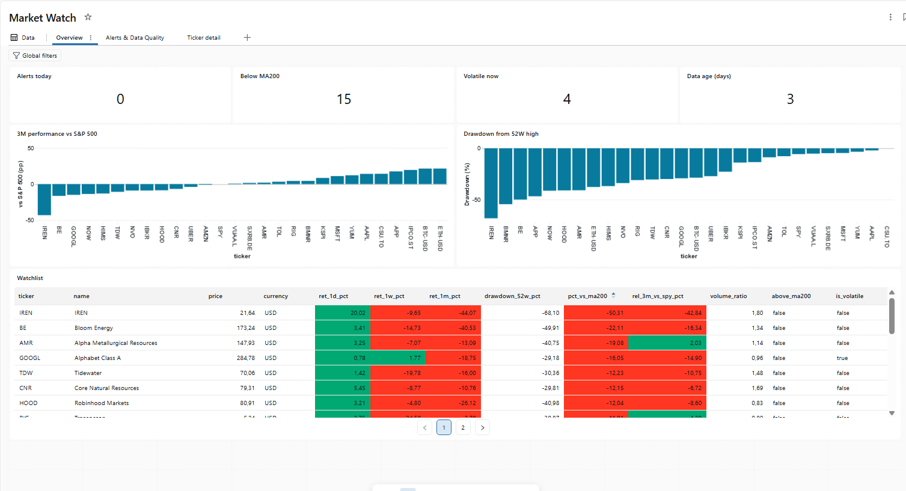
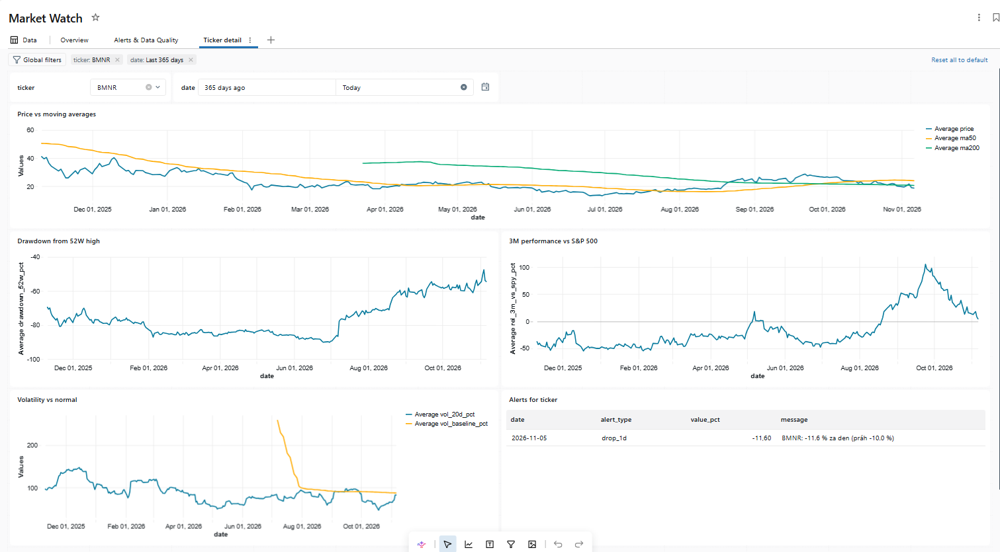
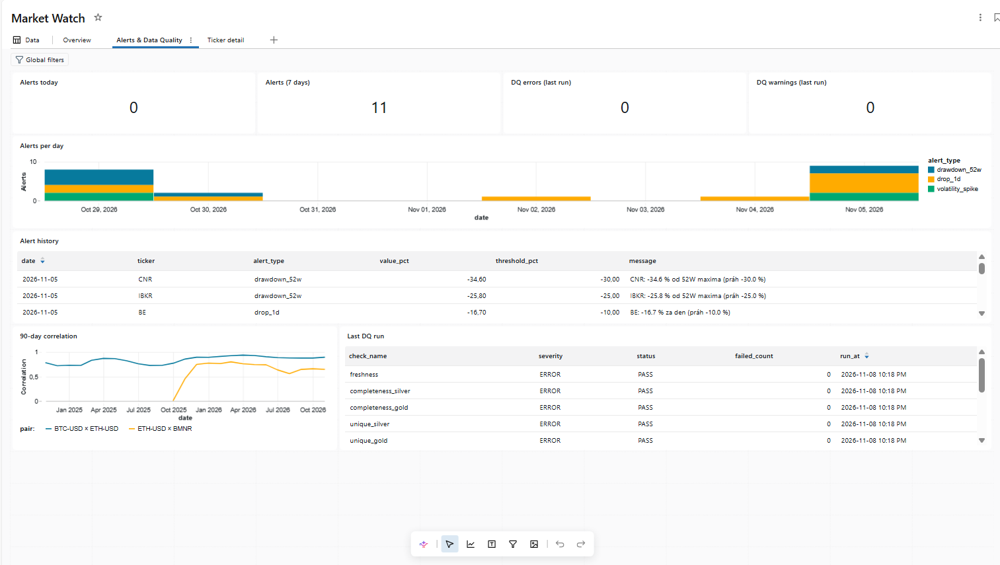

# Dashboard

Databricks AI/BI dashboard **Market Watch**, built on the gold layer. Definition in Git:
[`dashboards/market_watch.lvdash.json`](../dashboards/market_watch.lvdash.json)
(import: **Dashboards → Create dashboard → Import dashboard from file**).

Three pages, each answering one question.

## 1. Overview – "What is happening today?"

| Widget | Shows |
|---|---|
| Alerts today | new alerts from today's pipeline run |
| Below MA200 | how many watchlist tickers are in a long-term downtrend |
| Volatile now | how many tickers move more than their normal (`is_volatile`) |
| Data age (days) | age of the **oldest** ticker's last price – red from 5 days (same limit as the DQ freshness check) |
| 3M performance vs S&P 500 | leaders and laggards vs the market, in percentage points |
| Drawdown from 52W high | what is most "on sale" vs its 1-year high |
| Watchlist | latest metrics for every active ticker, green/red by sign |

## 2. Ticker detail – "What does one asset look like?"

Filters: **ticker** (single value) and **date** range (default last 365 days).

| Widget | Shows |
|---|---|
| Price vs moving averages | price with MA50 and MA200 – trend and crossovers |
| Drawdown from 52W high | how deep the price is below its 1-year high over time |
| 3M performance vs S&P 500 | periods of out- and underperformance |
| Volatility vs normal | 20-day volatility vs its own 1-year normal – spikes match `volatility_spike` alerts |
| Alerts for ticker | alert history of the selected ticker |

## 3. Alerts & Data Quality – "What did the system report, and is it healthy?"

| Widget | Shows |
|---|---|
| Alerts today / Alerts (7 days) | alert volume |
| DQ errors / DQ warnings (last run) | result of the last `30_dq_checks` run |
| Alerts per day | alerts by type over time – a market-wide sell-off shows up as a spike |
| Alert history | every alert with value, threshold and message |
| 90-day correlation | BTC × ETH and ETH × BMNR rolling correlation |
| Last DQ run | every check of the last run with status and failing sample |

## Datasets

| Dataset | Source | Used on |
|---|---|---|
| `watchlist_latest` | `gold_metrics` (last day per ticker) + `silver_watchlist` | Overview |
| `overview_kpi` | `gold_metrics` (last day per ticker) | Overview |
| `ticker_history` | `gold_metrics`, last 3 years | Ticker detail |
| `alerts_kpi`, `alerts_history` | `gold_alerts` | Overview, Ticker detail, Alerts & DQ |
| `dq_kpi`, `dq_last_run` | `dq_results` (last run) | Alerts & DQ |
| `correlations` | `gold_correlations`, last 2 years | Alerts & DQ |

All SQL is stored in the exported `.lvdash.json`.

## Design decisions

- **One question per page** – the overview answers "anything to look at?", the detail page answers "why?",
  the last page answers "can I trust it?".
- **Data age uses the oldest ticker**, not the newest: crypto updates every day, so the newest date would
  hide a stock that stopped updating.
- **Daily grain on time-series charts** – the default monthly grouping averaged away exactly the spikes
  (drawdown, volatility) the charts are meant to show.
- **AVG, not SUM, with a single-value ticker filter** – with one ticker AVG returns its exact value; without
  the filter AVG still shows something sensible instead of adding prices of different tickers together.
- **Colours only where the sign means something** – returns and relative performance are green/red;
  drawdown is always ≤ 0, so colouring it would make the whole column red.
- **Limited history in datasets** (3 years for detail, 2 years for correlation) keeps charts readable and fast;
  the full history stays in the gold tables.